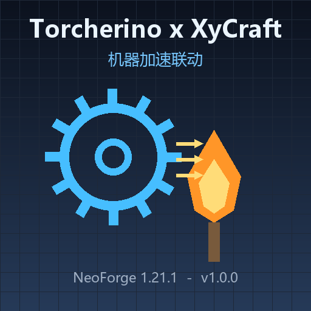

<p align="center">
  
</p>

<h1 align="center">Torcherino x XyCraft: Machines</h1>

<p align="center">
  A tiny compatibility patch that lets <b>Torcherino</b> (加速火把) actually speed up every
  <b>XyCraft: Machines</b> machine.<br>
  <code>Minecraft 1.21.1</code> · <code>NeoForge 21.1.x</code> · <code>MIT</code>
</p>

---

## Download

| File | Link |
|---|---|
| `torcherino_xycraft-1.0.0.jar` | [Releases → v1.0.0](https://github.com/Goduzun/torcherino-xycraft/releases/download/v1.0.0/torcherino_xycraft-1.0.0.jar) |
| All releases | [github.com/Goduzun/torcherino-xycraft/releases](https://github.com/Goduzun/torcherino-xycraft/releases) |

## 中文简介

加速火把加速原版机器的两条通道——`randomTick` 和 `BlockEntityTicker`——XyCraft 的机器两条都不走，
所以原版火把插在 XyCraft 机器旁边等于没插。这个补丁把火把的"每刻遍历范围内所有坐标"接到 XyCraft 自己的
tick 系统上：火把扫到一个 XyCraft 方块，就按火把当前 `speed` 值把该方块交给
`ServerBlockTickSystem#tickBlocks` 重放相应次数。

XyCraft 的加工进度是每个方块实体的倒计时（`CoreAttachments.ProcessTime`，每调用一次 `tickBlocks` 减 1，
减到 0 出货并重置为配方 `ticks`），所以重放 tick 就是**线性倍速**，不改配方、不伪造时间。

**生效范围**：提取器、物品/流体选择器、收集器、充电器、水力泵、虚空容器、氮气提取机，
以及粉碎机、冶炼机、搅拌机、离心机、精炼厂、低温舱、压缩机、矿石采集机、氩熔炉等全部多方块机器。

**上限**：单坐标 64 倍（双重压缩火把最高 324 会被截断），防止一个滑条把 TPS 拉穿。
给火把接红石信号关掉时，机器立刻回到原速。

## English

XyCraft machines are ticked by XyCraft's own `LevelTickEvent`-driven `ServerBlockTickSystem`,
not by `randomTick` or `Block#getTicker`, which is exactly the two channels Torcherino uses.
This patch injects at the tail of `TorcherinoBlockEntity#tickBlock(BlockPos)` — the method the
torch calls for every block position inside its field — and, when the block is an `XyBlock`,
replays `tickBlocks(...)` / `tickBatchBlocks(...)` on it `speed` times.

Because XyCraft stores progress as a per-block-entity countdown that is decremented by exactly
one per `tickBlocks` call, replaying ticks is a linear speed-up. No recipe edits, no fake clock.

## Install

1. Minecraft **1.21.1** + **NeoForge 21.1.x**
2. Requires: [XyCraft](https://www.curseforge.com/minecraft/mc-mods/xycraft),
   XyCraft: Machines (`xycraft_core`, `xycraft_machines`), and
   [Torcherino](https://www.curseforge.com/minecraft/mc-mods/torcherino) (`torcherino`)
3. Drop `torcherino_xycraft-1.0.0.jar` into `mods/`
4. Put an acceleration torch next to your machines, right-click it to set speed / range

Both sides need the mod (client + server).

## How it works

```java
@Mixin(TorcherinoBlockEntity.class)
public abstract class TorcherinoBlockEntityMixin {
    @Shadow private int speed;

    @Inject(method = "tickBlock", at = @At("RETURN"))
    private void torcherinoxycraft$driveXyCraftMachines(BlockPos pos, CallbackInfo ci) {
        Level level = ((BlockEntity) (Object) this).getLevel();
        if (level instanceof ServerLevel serverLevel) {
            XyAccel.boost(serverLevel, pos, serverLevel.getBlockState(pos), this.speed);
        }
    }
}
```

`XyAccel` looks up `XyBlock#_system` (a `DeferredHolder<ServerBlockTickSystem<?>>`) reflectively,
fetches the level's `BlockTickSystemLevelAttachment`, checks `isValidState(...)`, then invokes the
`protected` `tickBlocks` / `tickBatchBlocks` through cached `MethodHandle`s. Batch ticks follow the
vanilla cadence `(pos.asLong() + time) % data.frequency() == 0`.

Any internal failure disables the patch silently instead of throwing — a compat patch should never
take the server down.

## Build

No Gradle needed; plain `javac` against the installed game jars (see `build.ps1`):

```powershell
.\build.ps1
```

It compiles `src/main/java` against
`neoforge-<ver>-client.jar` (patched MC classes) + `client-<mcver>.jar` + `neoforge-<ver>-universal.jar`
+ `loader-*.jar` + `mixin-0.8.5.jar` + the XyCraft / Torcherino jars, then packages
`src/main/resources` into `build/torcherino_xycraft-1.0.0.jar`.

## License

MIT. Not affiliated with Soaryn (XyCraft) or the Torcherino authors.
